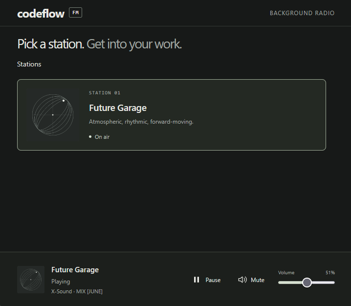

# Codeflow FM

Background music listenting app. **Listen live: [https://codeflowfm.pages.dev/](https://codeflowfm.pages.dev/)**



## Run locally

With Node.js 22 or later:

```sh
npm start
```

Open **http://127.0.0.1:4173**. No dependency installation is needed. Serve the files over HTTP; opening `index.html` as a `file://` URL cannot load the JSON catalog.

## Build and host

```sh
npm test
npm run build
```

Upload the contents of `dist/` to any static web host. It works at a domain root or a subdirectory. There is no application backend, database, authentication, or runtime Node requirement. To preview the build locally:

```sh
node scripts/serve.mjs --dist --port 4174
```

### Deploy to Cloudflare Pages

GitHub Actions tests and builds pull requests, then deploys successful pushes to `master` to the `codeflowfm` Cloudflare Pages project. The target production URL is **https://codeflowfm.pages.dev/**.

Follow the [Cloudflare Pages setup guide](docs/04-cloudflare-pages-deployment.md) to register the project, create an API token, and add the `CLOUDFLARE_ACCOUNT_ID` and `CLOUDFLARE_API_TOKEN` GitHub repository secrets. The workflow also supports manual deployment from the Actions tab.

## Listening behavior

- Clicking a station starts playback from the current point in its repeating schedule. The playlist's `generatedAt` timestamp anchors that schedule, and `durationSec` locates the track and offset. Listeners with accurate clocks tune into approximately the same point.
- Tracks advance automatically and the playlist loops endlessly. Pausing stops audio; Play rejoins the station's current scheduled position. Clicking an already playing station does not restart it.
- While a track plays, a second audio element preloads the next track. At the end, playback switches directly to that prepared element without fading or overlapping tracks. Loading is still possible if the connection or browser has not buffered enough audio.
- Local storage remembers the selected station, volume, and mute setting. Refreshing never starts audio automatically. Listening still works if storage is unavailable.
- The player shows loading, playing, paused, muted, and recoverable error states. After a playback/network error, click Play or the station card to retry. A stalled connection times out after 25 seconds.
- The browser streams audio directly from the playlist URLs. A fast first start depends on the connection and audio host. Tracks are not downloaded or cached for offline use. Mobile browsers and operating systems may control volume or suspend background playback.
- Listening requires browser support for WebM/Opus, checked using `canPlayType('audio/webm; codecs=opus')`. Unsupported browsers see an update message instead of station controls. Older iPhones, iPads, and Macs may need a system software update. No MP3 fallback is attempted.
- Keyboard users can Tab to the station, activate it with Enter or Space, and use the player controls. The volume slider supports arrow keys. The station chooser's overflow scrollbar supports keyboard and pointer input.

## Add a station

1. Add a playlist JSON file under `assets/`, following `assets/playlist.schema.json`. Every track needs a public HTTP(S) `url`, a positive `durationSec` for scheduling, and `mime`: use `audio/webm; codecs=opus` (or `audio/webm`) for WebM containing Opus audio. Existing MP3 tracks use `audio/mpeg`. Each track has one URL, with no alternate-format fallback.
2. Add an entry to `assets/stations.json` with `id`, `name`, `description`, `artwork`, and `playlist`. Paths are relative to the app root, for example `./assets/another-playlist.json`.
3. Match the catalog entry's `id` to the playlist's `station.id`, and run the build again.

The chooser scales to multiple stations without changing the player. The catalog includes Future Garage and Lo-Fi Beats.

Serve WebM files with the HTTP `Content-Type: audio/webm` header and byte-range support so the browser can seek into long tracks. Changing a playlist's MIME type does not convert audio: upload actual Opus-encoded WebM files and update the filenames, URLs, hashes, sizes, and durations. The included Future Garage playlist still points to its existing MP3 library.

## Audio maintenance tools

Use the [playlist builder](tools/build-playlist.md) to prepare MP3 or WebM/Opus filenames and generate playlist JSON files for a station.

Use the [absolute-silence cleaner](tools/clean-mp3-silence.md) to scan MP3 folders, preview detected gaps with `--dryrun`, and create cleaned copies beside untouched originals. Both modes produce JSON reports.

## Implementation decisions

See [implementation notes](docs/03-implementation-notes.md) for the spec reconciliation and low-fidelity structure. The frontend uses browser-native JavaScript, CSS, and two reusable audio elements for playback and preloading. The small Node scripts are only local development/build tools.
